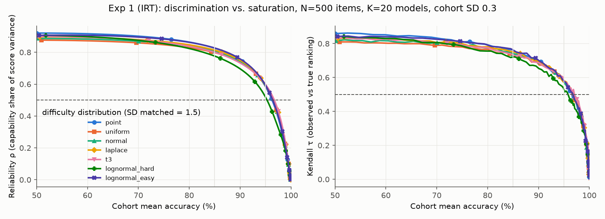
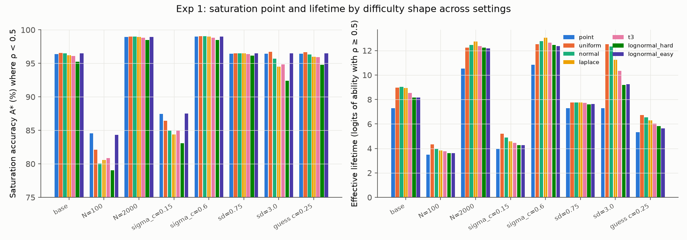
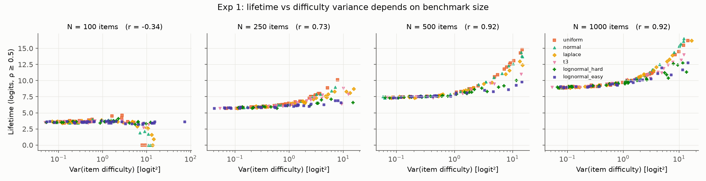
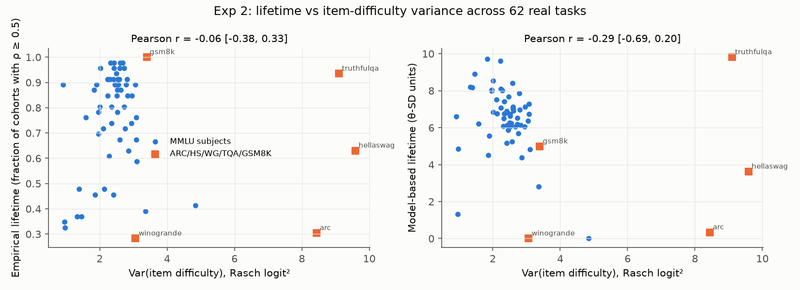
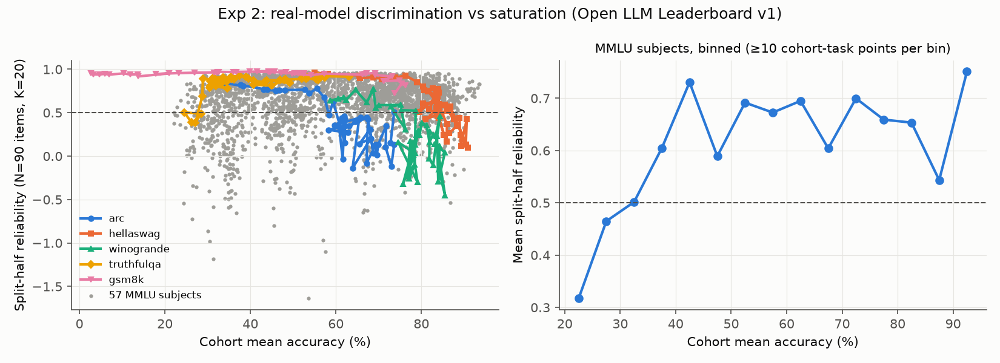
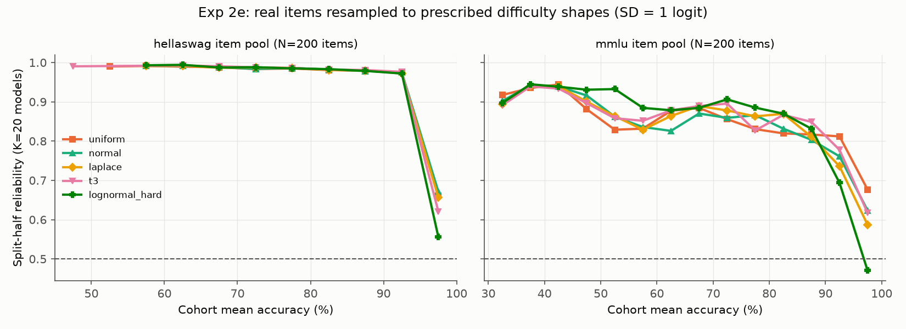
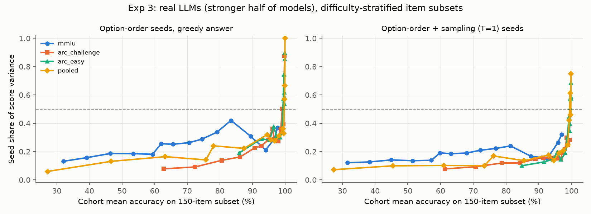
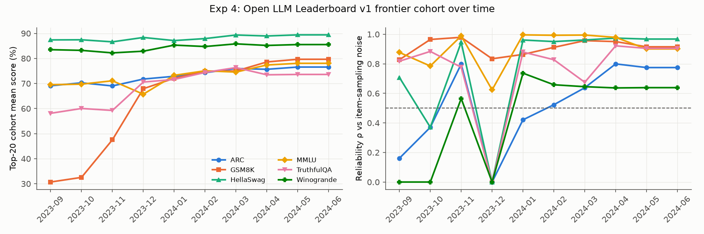

# Benchmark Saturation Dynamics: When Leaderboard Progress Stops Reflecting Capability Gains

## 1. Executive Summary

**Question.** Does the shape and variance of a benchmark's item-difficulty distribution decide when it
stops discriminating between models? And does evaluation-seed noise dominate rankings at saturation?

**Answer.** Mostly no. The hypothesis has three parts, and the evidence goes against two and gives
only conditional support to the third.

- **H1: uniform saturates at 85%, heavy-tailed holds to 95%.** Not supported. In a controlled IRT
  analysis with matched variance, all seven difficulty shapes lose discrimination (reliability ρ < 0.5)
  within about 1.5 points of each other: at 95.2–96.6% cohort mean accuracy for a 500-item benchmark.
  The hard-tailed shape actually fails slightly *earlier*, not later. Real MMLU and HellaSwag items
  resampled into these shapes and scored by 110 held-out real LLMs reproduce the null.
  - What does move the saturation accuracy is **benchmark size**: about 80–84% at 100 items, 96% at
    500, and 99% at 2000.
  - The other driver is **how similar the competing models are**: 83–88% when the cohort spread is
    0.15 logits, versus 99% at 0.6.
- **H3: lifetime correlates with difficulty variance at r > 0.8.** Only conditionally true.
  - In simulation, the correlation is r = 0.92 among benchmarks with a fixed size of N ≥ 500.
  - It drops to r = 0.20 when item counts vary, and is *negative* at N = 100. Spreading a small item
    budget over a wide difficulty range thins the item density at any one ability level.
  - Across 62 real tasks (220 Open LLM Leaderboard models), lifetime is uncorrelated with difficulty
    variance: r = −0.06, 95% CI [−0.38, 0.33].
- **H2: seed noise dominates ranking variance at saturation.** Conditionally true.
  - For 15 real open LLMs (0.5–14B) with 10 option-order seeds, seed noise is about 0.40× the
    binomial item-sampling noise.
  - On full 500-item benchmarks it explains 1–18% of score variance, even for the 96%-accuracy
    ARC-Easy frontier cohort.
  - Its share rises steeply with accuracy (Spearman 0.96) but exceeds 50% only for near-tied cohorts
    on 150-item subsets at ≥ 99% accuracy.
  - Applied to the real v1 leaderboard top-20, the predicted seed share is at most 14%.

**Practical implication.** To extend a benchmark's useful life, add items near the frontier and keep
the item count large. The shape of the difficulty histogram matters little. Rank differences between
near-tied frontier models on small test sets (≤ 200 items, accuracy ≥ 95%) should be reported with
seed-level error bars, because there the noise can genuinely outweigh capability.

## 2. Research Question & Motivation

**Hypothesis (as given).**
- Benchmarks with uniform difficulty distributions saturate fastest, losing discriminative power when
  mean accuracy exceeds 85%.
- Heavy-tailed distributions keep discriminating up to 95% mean accuracy.
- At saturation, random-seed variation accounts for more ranking variance than true capability
  differences.
- A benchmark's effective lifetime correlates strongly (r > 0.8) with the variance of its item
  difficulty distribution.

**Why it matters.** Leaderboard ranks drive model selection and research attention. If design
properties of a benchmark predict when its ranks stop being meaningful, builders can design
longer-lived benchmarks, and readers know when to stop trusting small rank gaps.

**Gap.** The workspace had no pre-gathered literature review, papers or datasets, so the context
below is from the author's own knowledge. Prior work has established several pieces:
- IRT structure in LLM benchmarks: tinyBenchmarks (Polo et al., 2024) and metabench (Kipnis et al., 2024).
- Non-trivial seed and prompt variance in evaluations: Madaan et al., 2024, "Quantifying Variance in
  Evaluation Benchmarks"; Miller, 2024, "Adding Error Bars to Evals".
- Rapid benchmark saturation: Kiela et al., 2021; Ott et al., 2022.

What is missing is a quantitative link between the *difficulty distribution* and the *accuracy at
which discrimination collapses*, separating shape from variance from size, plus a measurement of seed
versus capability variance as a function of saturation.

## 3. Methodology

### Definitions (used throughout)
- **Cohort:** K contemporaneous models with similar ability, standing for the current frontier.
- **Reliability ρ:** the share of between-model score variance that is *not* noise.
  - In simulation: ρ = Var(true scores) / [Var(true scores) + mean noise variance].
  - On real data: the split-half reliability (Spearman–Brown corrected) across the cohort, or
    1 − binomial noise / observed variance.
  - 1 − ρ is the noise share of ranking variance. ρ < 0.5 means noise dominates capability, so it is
    the natural "lost discriminative power" threshold.
- **Saturation accuracy A\*:** the cohort mean accuracy at which ρ first falls below 0.5 as ability
  rises. Thresholds of ρ = 0.7 and Kendall τ = 0.5 were also reported.
- **Effective lifetime:** the length of the ability axis (≈ time under steady progress) over which ρ ≥ 0.5.

### Exp 1: controlled IRT model (`src/exp1_irt_saturation.py`)

> This simulates item *responses* under an IRT model. It does **not** simulate LLMs, and every claim
> is re-tested on real LLM data in Exp 2–4.

- **Response model:** 2PL/3PL, P = c + (1−c)·σ(a(θ−b)), with a ~ LogNormal(0, 0.3).
- **Difficulty shapes** for b, with SD matched to 1.5 logits:
  - point (all items equally hard), uniform, normal, Laplace, Student-t₃;
  - log-normal with a long *hard* tail, and log-normal with a long *easy* tail.
- **Base setting:** N = 500 items, K = 20 models, cohort SD σ_c = 0.3 logits.
- **Frontier sweep:** the cohort centre is moved across 221 ability levels.
- **Noise model:** exact Poisson-binomial mean and variance of accuracy. Kendall τ is computed by
  Monte Carlo with 200 replicates.
- **Replication:** 20 independent item draws per shape × 10 sensitivity settings: N ∈ {100, 2000},
  σ_c ∈ {0.15, 0.6}, SD ∈ {0.75, 3}, guessing c = 0.25, K = 10, and a fixed at 1.
- **Lifetime vs variance:** 600 random benchmark configurations (random shape, SD 0.25–4,
  N ∈ {100, 250, 500, 1000}).

### Exp 2: real LLM response data (`src/download_v1_details.py`, `build_matrices.py`, `exp2_real_benchmarks.py`)

**Data**
- Per-item correctness from the public Open LLM Leaderboard v1 "details" datasets
  (`open-llm-leaderboard-old/details_*`).
- 245 models were sampled, stratified across 20 quantile bins of leaderboard Average plus the
  top 25. 227 models had at least 60 of the 62 tasks, and the **220** with all 62 tasks were
  used.
- Tasks: ARC-Challenge (25-shot, acc_norm), HellaSwag (10-shot, acc_norm), TruthfulQA-mc1,
  Winogrande (5-shot), GSM8K (5-shot), and 57 MMLU subjects (5-shot). That gives **62 tasks** and
  91–10,019 items per task.
- Items are keyed by a hash of their normalised text. Quality control kept items answered by
  ≥ 95% of models, leaving 0% missing cells.

**Calibration/evaluation split (avoids selection leakage)**
- Models were ordered by an *external* ability score: the mean z-score of the benchmarks other than
  the task's own.
- Alternate models went to a calibration half and an evaluation half (≈ 110 each).
- Item difficulties were estimated only on the calibration half. Discrimination was measured only on
  the evaluation half.

**Analyses**
- **2a. Difficulty per task:** Rasch model (joint MAP, PyTorch L-BFGS). Recorded Var(b), SD, IQR,
  90% range, skew, kurtosis, and Var(logit p). A fixed 25% guessing floor was tried first and
  rejected: 26% of ARC items are answered *below* chance (adversarial distractors), which makes a
  guessing floor misfit.
- **2b. Empirical discrimination:** sliding cohorts of K = 20 evaluation models along the external
  ability axis (step 2). For each cohort: split-half reliability on random 90-item subsamples, so all
  tasks have equal N. **Empirical lifetime** is the fraction of cohorts with ρ ≥ 0.5.
- **2c. Model-based lifetime:** the Exp-1 ρ-curve evaluated with each task's *real* fitted
  difficulties (N = 90, cohort spread estimated from the data). It is expressed in units of the
  population θ-SD and is not censored by the observed ability range.
- **2d. Lifetime vs Var(b)** across the 62 tasks: Pearson and Spearman correlations, bootstrap 95% CI
  (2000 resamples), and a partial correlation controlling for mean accuracy.
- **2e. Real-item resampling (direct H1 test):**
  - Item pools: all MMLU items (14k) and all HellaSwag items (10k).
  - Benchmarks of 200 items were drawn with prescribed difficulty shapes (uniform, normal, Laplace,
    t₃, hard-tailed log-normal; SD 1 logit) by importance resampling.
  - 12 difficulty locations × 6 replicates per shape.
  - Each was scored with the evaluation half's real responses, giving split-half ρ vs cohort accuracy.

### Exp 3: real-LLM seed variance (`src/seed_eval.py`, `exp3_seed_analysis.py`, `h2_crosscheck.py`)

**Models and data**
- 15 open instruction-tuned LLMs, run locally in bf16 on 2× RTX A6000:
  - Qwen2.5-{0.5, 1.5, 3, 7, 14}B-Instruct
  - Qwen3-{1.7, 4, 8}B (thinking disabled)
  - SmolLM2-1.7B-Instruct, Phi-3.5-mini-instruct, Phi-4-mini-instruct
  - OLMo-2-1124-7B-Instruct, granite-3.1-8b-instruct, Yi-1.5-9B-Chat, Mistral-7B-Instruct-v0.3
- 1,500 items: 500 each from ARC-Easy, ARC-Challenge and MMLU (test splits, seed 42).

**Prompting and seeds**
- 0-shot chat-template multiple-choice prompt, followed by the assistant prefix "The answer is".
- The answer is read from the next-token probability mass on the letters A–D, renormalised over A–D.
- **10 evaluation seeds** per item. Seed 0 is the original option order; seeds 1–9 are random option
  permutations. That is 15,000 forward passes per model.

**Scores**
- *Greedy:* argmax over the letters, so only the option-order seed varies.
- *Sampled:* the answer is drawn from the letter distribution at T = 1, adding sampling noise on top
  of option order.

**Analysis**
- **Variance decomposition:**
  - Seed variance = mean over models of the across-seed variance.
  - Capability variance = variance of the model means minus seed variance / S.
  - Seed share = seed / (seed + capability).
- **Ranking-stability metrics:** Kendall τ between a single-seed ranking and the seed-averaged ranking;
  pairwise flip probability between two single-seed runs; agreement on the top-1 model.
- **Saturation levels:**
  - (i) natural benchmarks, with cohorts of all models, the top 10 and the top 6;
  - (ii) difficulty-stratified 150-item subsets (15 windows from hardest to easiest). Item difficulty
    is estimated on the *weaker* 7 models; seed share is measured on the *stronger* 8.
- **Cross-check against the real leaderboard:** the per-item seed-noise constant
  κ = N·Var_seed(acc) ≈ r·acc(1−acc) was fitted, then applied to the real v1 top-20 score spreads.

### Exp 4: real leaderboard history (`src/exp4_leaderboard_history.py`)
- For each month from Sep 2023 to Jun 2024: the top 20 unique models by Average among all
  submissions up to that month (7,000+ entries).
- For each benchmark: cohort mean, SD, binomial noise, and ρ.

### Environment
- Python 3.14 (uv venv); torch 2.14 (CUDA); transformers 5.19; numpy, pandas, scipy, statsmodels, matplotlib.
- Random seed 42 everywhere.
- Compute: shared 32-core CPU for Exp 1/2/4; 2× RTX A6000 for Exp 3 (≈ 1–6 min per model).
- No paid API was used. No LLM API keys were available, so all LLM outputs are either from the
  public leaderboard or from local inference.

## 4. Results

### Exp 1: the shape of the difficulty distribution barely moves the saturation point

**Saturation accuracy A\*, cohort mean accuracy (%) at which ρ < 0.5.** Values are means over 20 item
draws, with SD matched within each row.

| setting | point | uniform | normal | Laplace | t₃ | lognormal-hard | lognormal-easy |
|---|---|---|---|---|---|---|---|
| **base (N=500, σ_c=0.3, SD=1.5)** | 96.4 | 96.6 | 96.5 | 96.2 | 96.1 | **95.2** | 96.5 |
| N = 100 items | 84.5 | 82.1 | 80.1 | 80.6 | 80.8 | 79.1 | 84.4 |
| N = 2000 items | 99.0 | 99.0 | 99.0 | 99.0 | 98.8 | 98.5 | 99.0 |
| tight cohort σ_c = 0.15 | 87.5 | 86.4 | 85.0 | 84.4 | 85.0 | 83.1 | 87.5 |
| wide cohort σ_c = 0.6 | 99.0 | 99.0 | 99.0 | 99.0 | 98.9 | 98.5 | 99.0 |
| wide difficulties SD = 3 | 96.4 | 96.7 | 95.7 | 94.5 | 94.8 | 92.4 | 96.5 |
| guessing c = 0.25 | 96.5 | 96.6 | 96.4 | 96.0 | 96.0 | 94.8 | 96.5 |

Using Kendall τ < 0.5 instead (base setting) gives A\* = 95.7–96.9% for every shape.

**Effective lifetime (logits of frontier ability with ρ ≥ 0.5):**

| setting | point | uniform | normal | Laplace | t₃ | lognormal-hard |
|---|---|---|---|---|---|---|
| base SD = 1.5 | 7.3 | 9.0 | 9.0 | 8.9 | 8.5 | 8.2 |
| SD = 3.0 | 7.3 | **12.5** | 12.3 | 11.3 | 10.4 | 9.2 |
| N = 100 | 3.5 | 4.3 | 4.0 | 3.8 | 3.8 | 3.6 |

**Lifetime vs difficulty variance (600 random configurations):**
- Pooled over N: Pearson r = 0.20 (Spearman 0.27).
- Split by benchmark size:

| N | r |
|---|---|
| 100 | −0.34 |
| 250 | 0.73 |
| 500 | 0.92 |
| 1000 | 0.92 |

- Within N = 500, the 90% difficulty range predicts lifetime slightly better: r = 0.96.

### Exp 2: real benchmarks (220 LLMs × 62 tasks)

**Lifetime vs item-difficulty variance across 62 tasks (H3):**

| lifetime measure | Pearson r with Var(b) [95% bootstrap CI] | Spearman | partial r given mean acc. |
|---|---|---|---|
| empirical (fraction of cohorts with split-half ρ ≥ 0.5) | −0.06 [−0.38, 0.33] | 0.08 | −0.14 |
| empirical (binomial ρ) | −0.10 [−0.45, 0.30] | −0.17 | −0.08 |
| model-based (real difficulties, θ-SD units) | −0.29 [−0.69, 0.20] | −0.35 | −0.25 |

- Alternative variance measures (SD, IQR, 90% range, Var(logit p)) all give |r| < 0.3.
- Restricted to the 57 MMLU subjects (a homogeneous format), r = 0.18 (p = 0.17).

**Discrimination vs cohort accuracy:**
- Real cohorts of 20 models, scored on 90-item subsamples, rarely exceed 0.7 split-half reliability
  at any accuracy level (mean 0.51–0.69 per accuracy bin).
- Cohort spread and item count dominate. Two of the most saturated tasks lose discrimination for the
  top cohort:

| task | top-cohort accuracy | top-cohort ρ (90-item subsamples) | peak ρ (lower cohorts) |
|---|---|---|---|
| HellaSwag | 91% | 0.10 | 0.96 |
| Winogrande | 86% | 0.23 | 0.77 |

- GSM8K (generative) and TruthfulQA kept high reliability for the top cohort: 0.72 and 0.91.

**Direct H1 test with real items** (200-item benchmarks built to a prescribed shape, mean split-half ρ,
K = 20 real models):

| pool | shape | 80–85% acc | 85–90% | 90–95% | 95–100% |
|---|---|---|---|---|---|
| MMLU | uniform | 0.82 | 0.82 | **0.81** | **0.68** |
| MMLU | normal | 0.83 | 0.80 | 0.76 | 0.62 |
| MMLU | Laplace | 0.87 | 0.80 | 0.74 | 0.59 |
| MMLU | t₃ (heavy) | 0.87 | 0.85 | 0.78 | 0.62 |
| MMLU | lognormal-hard (heavy hard tail) | 0.87 | 0.82 | 0.69 | **0.47** |
| HellaSwag | all 5 shapes | 0.98 | 0.98 | 0.97 | 0.55–0.62 |

The uniform shape does **not** saturate at 85%. On real items it is, if anything, the *most* robust
above 90% accuracy, and the hard-tailed shape is the least robust.

### Exp 3: real-LLM seed variance (15 models, 10 option-order seeds)

**Greedy accuracy, averaged over seeds:** ARC-Easy ranges from 59.5% (Qwen2.5-0.5B) to 97.3%
(Qwen2.5-14B). Per-model seed SDs of accuracy on 500 items (greedy, median and range across models):

| benchmark | median seed SD | range |
|---|---|---|
| ARC-Easy | 0.75 pts | 0.43–1.83 pts |
| ARC-Challenge | 0.95 pts | 0.43–2.22 pts |
| MMLU | 1.30 pts | 0.68–2.54 pts |

**Seed-noise magnitude:**
- N·Var_seed(acc) ≈ 0.40 × acc(1−acc) (median ratio).
- Per benchmark: 0.40 on ARC-Challenge, 0.45 on ARC-Easy, 0.37 on MMLU.

**Natural benchmarks, 500 items each** (seed share of score variance; ranking stability):

| benchmark | cohort | mean acc | seed share (greedy) | seed share (sampled) | Kendall τ, single seed vs mean | pairwise flip prob. |
|---|---|---|---|---|---|---|
| MMLU | all 15 | 60% | 0.02 | 0.02 | 0.95 | 0.03 |
| MMLU | top 6 | 69% | 0.10 | 0.10 | 0.90 | 0.06 |
| ARC-C | all 15 | 78% | 0.01 | 0.01 | 0.95 | 0.04 |
| ARC-C | top 6 | 88% | 0.10 | 0.09 | 0.89 | 0.09 |
| ARC-E | all 15 | 90% | 0.01 | 0.01 | 0.91 | 0.06 |
| ARC-E | top 6 | **96.0%** | **0.18** | 0.15 | 0.81 | 0.14 |

Single-seed runs pick the same top-1 model as the seed average in 40–100% of cases. On ARC-E, a
single greedy seed identifies the seed-averaged winner only 40% of the time. The item-bootstrap
95% intervals for seed share are in `results/exp3/natural_benchmarks.csv`. The percentile bootstrap is
upward-biased here, because resampled duplicate items inflate seed variance. Even its upper bounds
stay below 0.5 (the largest is 0.46, for the ARC-E top-6 cohort).

**Effect of benchmark size** (ARC-E top-6 cohort, greedy):

| items | seed share |
|---|---|
| 50 | 0.51 |
| 100 | 0.45 |
| 200 | 0.32 |
| 500 | 0.18 |

**Difficulty-stratified 150-item subsets (stronger 8 models):**
- Seed share rises with cohort accuracy (pooled items: Spearman ρ = 0.96, p < 10⁻⁸ for greedy;
  0.97, p < 10⁻⁹ for sampled).
- Mean seed share is 0.46 when accuracy ≥ 90%, versus 0.15 below 80% (greedy).
- On MMLU it peaks at 0.42 (83% accuracy). On ARC-C and ARC-E it exceeds 0.5 only at ≥ 99.2%
  accuracy, where nearly every item is solved by every model.

**Cross-check on the real leaderboard.** The fitted seed-noise rate was applied to the v1 top-20 as
of Jun 2024:

| benchmark | top-20 mean | top-20 SD | predicted seed SD | predicted seed share |
|---|---|---|---|---|
| ARC | 76.6% | 2.6 pts | 0.78 pts | 0.09 |
| HellaSwag | 89.4% | 1.7 pts | 0.19 pts | 0.01 |
| MMLU | 78.1% | 1.1 pts | 0.22 pts | 0.04 |
| TruthfulQA | 73.6% | 5.0 pts | 0.97 pts | 0.04 |
| Winogrande | 85.5% | 1.6 pts | 0.62 pts | 0.14 |
| GSM8K | 79.7% | 3.8 pts | 0.70 pts | 0.03 |

### Exp 4: real leaderboard trajectories

- Frontier (top-20) means rose over the period:
  - GSM8K from 31% to 80%, the fastest rise;
  - MMLU from 70% to 78%;
  - HellaSwag from 87% to 89%.
- Reliability against item-sampling noise stayed ≥ 0.9 for HellaSwag, MMLU, GSM8K and TruthfulQA in
  most months after Jan 2024. These benchmarks have large N (10k–14k items for HellaSwag and MMLU).
- Smaller benchmarks were less reliable at lower accuracy: Winogrande (1,267 items) at about 0.64,
  and ARC at about 0.4–0.8.
- Several months show ρ ≈ 0 for every benchmark at once (e.g. Dec 2023). In those months the top-20
  is dominated by near-duplicate merges whose scores differ less than item-sampling noise. This is
  saturation of the *cohort*, not of a benchmark.

## 5. Analysis & Discussion

**H1: refuted as stated.**
- Shape at matched variance changes the saturation accuracy by about 1.5 points in theory. Every
  shape is sub-1.5-point except the hard-tailed log-normal, which is ≈ 1–4 points worse.
- On real items the differences are within noise, with uniform marginally *best*.
- Mechanism: once accuracy is fixed, the number of items whose difficulty lies near the cohort's
  ability is set by the remaining error mass, 1 − A. A heavy hard tail spends that error mass on items
  far *above* the cohort, which no model solves and which therefore do not discriminate.
- The 85%-vs-95% contrast in the hypothesis does appear, but along a different axis:
  - **benchmark size**: A\* ≈ 80–84% at N = 100 versus 96% at N = 500;
  - **cohort tightness**: 83–88% at σ_c = 0.15 versus 99% at σ_c = 0.6.

**H3: true only within a family of benchmarks of equal size.**
- At fixed N ≥ 500, spreading difficulties widens the ability window the benchmark covers, so
  lifetime tracks Var(b) (r = 0.92).
- But variance trades off against density. At N = 100, more variance means fewer items near any
  frontier, and lifetime falls (r = −0.34).
- Real tasks differ in N, format, item discrimination, below-chance distractors and dimensionality.
  Their difficulty variances explain essentially none of the variance in lifetime (r ≈ 0 to −0.3).
  HellaSwag has the largest Var(b) yet saturates for the top cohort; GSM8K has modest Var(b) yet is
  discriminative throughout.
- **Item informativeness near the frontier**, meaning the item count weighted by discrimination
  around the current θ, is the more natural predictor.

**H2: conditionally true.**
- Option-order and sampling seeds add noise equal to roughly 0.40× the binomial item-sampling noise.
- Whether that noise dominates depends on the ratio of that noise to the real capability spread:
  (noise per item / N) / spread².
- On real leaderboards with 800–14,000 items it does not dominate: ≤ 14% predicted share; 18% for
  our near-ceiling (96%) 500-item ARC-E cohort.
- It does dominate for near-tied cohorts at ≥ 99% accuracy on ≈ 150 items, and the share grows
  steadily with accuracy (Spearman ρ ≈ 0.96). So "at saturation" is the right
  direction, but the threshold depends on N and on the cohort's spread.

**Surprises.**
1. 26% of ARC-Challenge items are answered below chance by the model population (adversarial
   distractors). This breaks guessing-floor IRT models.
2. Leaderboard top-20s often saturate because of near-duplicate merges rather than the benchmark
   itself.
3. Qwen3-8B, Phi-3.5 and SmolLM2 put only 12–33% of next-token mass on the bare letters. Accuracies
   after renormalising over A–D are still sensible (e.g. Qwen3-8B 91% on ARC-C), but this adds
   format-sensitivity noise.

## 6. Limitations

- **Seed type.** Seeds here are *evaluation* seeds: option order plus sampling. Training-seed
  variance (as in Madaan et al., 2024) could not be measured and could be larger.
- **Cohort.** Exp 3 uses 15 models of 0.5–14B parameters, not frontier API models; no API keys were
  available. Llama-3.1-8B and Gemma-2-9B were gated and inaccessible.
- **Leaderboard data.**
  - Exp 2 and 4 use v1 leaderboard data (2023–24 open models, logprob scoring) that saturated
    relatively early.
  - The v2 per-item data is gated.
  - The ability axis in Exp 2 is an external composite. Calendar-time lifetimes were measured only
    for six benchmarks (Exp 4) and are confounded by cohort composition (merges).
- **Model fit.** The Rasch model is unidimensional. MMLU pooling and per-task difficulty variances
  carry multidimensionality and prior-shrinkage effects; extreme items are bounded by the N(0, 3²)
  prior.
- **Resampling.** Importance resampling from finite pools only approximates the target shapes. For
  example, the achieved kurtosis of t₃ was 4–5, and lognormal-hard reached 10–16.
- **Bootstrap.** Item-bootstrap CIs for seed share are upward-biased, as noted in Exp 3.
- **Data contamination.** ARC and MMLU are likely in the training data of the Exp 3 models. This
  affects absolute accuracy but not the variance decomposition.

## 7. Conclusions & Next Steps

**Answer.** The shape of a benchmark's item-difficulty distribution does not decide when it
saturates. All shapes lose discrimination at nearly the same accuracy, which is set mainly by the
number of items and by how close the competing models are. Difficulty variance predicts lifetime
only among equal-size benchmarks (r = 0.92 in theory, ≈ 0 across real tasks). Evaluation-seed noise
outweighs capability differences only for near-tied frontier cohorts on small test sets at ≥ 99%
accuracy.

**Recommendations for benchmark builders**
- Budget items near the expected frontier: an adaptive or IRT-targeted item bank.
- Keep N large.
- Report seed-level and item-level error bars whenever the frontier cohort is within about 1–2 pts
  and accuracy is above 95%.

**Follow-ups**
1. Repeat Exp 3 with frontier API models and training-seed replicates.
2. Use v2 or HELM per-item data with release dates to measure lifetimes in calendar time.
3. Test "frontier item information" (Σ Fisher information at the cohort θ) as a lifetime predictor.
4. Deduplicate leaderboard cohorts by base model.

## References
- Polo et al. (2024). tinyBenchmarks: evaluating LLMs with fewer examples.
- Kipnis et al. (2024). metabench – A Sparse Benchmark to Measure General Ability in LLMs.
- Madaan et al. (2024). Quantifying Variance in Evaluation Benchmarks.
- Miller (2024). Adding Error Bars to Evals.
- Kiela et al. (2021). Dynabench. Ott et al. (2022). Mapping global dynamics of benchmark creation and saturation.
- Data:
  - Open LLM Leaderboard v1 contents and details (HF `open-llm-leaderboard-old/*`);
  - AI2 ARC (`allenai/ai2_arc`);
  - MMLU (`cais/mmlu`).
